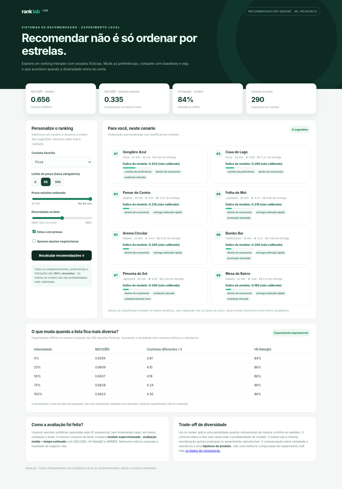

# RankLab

**Um experimento de recomendação de restaurantes com Machine Learning, avaliação de ranking e diversidade.**

[](requirements.txt) [](https://github.com/lucastnunes06/ranklab-recommender-system/actions) [](LICENSE)

Uma nota média não diz tudo sobre uma recomendação. Uma pessoa pode preferir uma cozinha específica, ter um orçamento limitado ou precisar de uma entrega mais rápida. O **RankLab** foi construído para explorar como esses fatores alteram a ordem de uma lista e como avaliar essa escolha.

É um **protótipo local**, sem integração com aplicativos de delivery. Usuários, restaurantes, cliques, avaliações e prazos são sintéticos. Não há resultados comerciais nem clientes reais.

## Veja o que funciona



[Ver GIF: mudando a diversidade e a cozinha preferida](docs/recommendations-demo.gif)

Na demonstração é possível selecionar cozinha, faixa de orçamento, preferência vegetariana, prazo máximo, urgência e intensidade de diversidade. O sistema retorna oito opções classificadas, com score do modelo e motivos simples para cada posição. Os motivos são regras de apresentação — **não explicações causais do modelo**.

> A captura e o GIF usam o HTML/CSS/JS do projeto e respostas calculadas pelo próprio backend via `TestClient`. Não são imagens conceituais nem registros de uma operação real. O script da captura está em [`docs/capture_dashboard.py`](docs/capture_dashboard.py).

## O que foi implementado

| Componente | Implementação |
| --- | --- |
| Dados de demonstração | 48 restaurantes inventados e 1.450 sessões simuladas, com 12 candidatos por sessão |
| Modelo | `HistGradientBoostingClassifier` com pré-processamento de atributos categóricos; previsão de clique por candidato |
| Avaliação | NDCG@5, Hit Rate@5, MRR@5, tempo estimado médio e diversidade no top 5 |
| Comparações | Ranking pela avaliação média e ranking pelo menor tempo estimado |
| Reordenação | Penalidade heurística para cozinhas repetidas, aplicada **após** os scores do modelo |
| Aplicação | FastAPI, painel em HTML/CSS/JavaScript e endpoints REST |
| Qualidade | Testes com `pytest`, CI e scripts para reproduzir treinamento, métricas e imagens |

A classificação é **pointwise**: o modelo estima uma probabilidade por restaurante e os scores são ordenados. Não implementa uma função de perda pairwise/listwise, embeddings de usuários ou recomendação em produção.

## Executar localmente

**Requisitos:** Python 3.11 ou superior e Git. Não precisa de chave de API.

```bash
git clone https://github.com/lucastnunes06/ranklab-recommender-system.git
cd ranklab-recommender-system
python -m venv .venv
```

Ative o ambiente virtual:

**Linux/macOS**

```bash
source .venv/bin/activate
```

**Windows (PowerShell)**

```powershell
.venv\Scripts\Activate.ps1
```

Instale as dependências, reproduza os resultados e inicie a API:

```bash
pip install -r requirements.txt
python scripts/train.py
python scripts/diversity_study.py
uvicorn ranklab.api:app --reload --port 8001
```

Abra [http://localhost:8001](http://localhost:8001) para usar o painel ou [http://localhost:8001/docs](http://localhost:8001/docs) para explorar a API.

O ZIP inclui o modelo e os arquivos de métricas prontos para demonstração. `train.py` recria os artefatos com uma semente fixa. **Carregue apenas artefatos `.joblib` de fontes confiáveis.**

### Exemplo pela API

```bash
curl 'http://localhost:8001/api/recommendations?cuisine=Pizza&budget=2&rush=true&diversity=0.5&max_eta=45'
```

Outros endpoints: `GET /api/cuisines`, `GET /api/metrics` e `GET /api/diversity-study`.

## Resultados: o modelo é melhor que ordenar por estrelas?

Para esta simulação, sim. No conjunto de **290 sessões de teste**, usando os mesmos candidatos em cada comparação:

| Estratégia | NDCG@5 | Hit Rate@5 | MRR@5 |
| --- | ---: | ---: | ---: |
| **Modelo supervisionado** | **0,5696** | **0,7897** | **0,4971** |
| Avaliação média, maior primeiro | 0,2857 | 0,4828 | 0,2224 |
| Entrega estimada, menor primeiro | 0,3757 | 0,6034 | 0,3011 |

O NDCG@5 valoriza posicionar um item relevante nas primeiras posições. Como a interação é simulada, a tabela demonstra apenas que o modelo se ajustou melhor **às regras usadas para gerar esses cliques**. Não mede CTR, conversão ou satisfação de pessoas reais.

Resultados completos: [`artifacts/metrics.json`](artifacts/metrics.json). O treino separa **870 sessões para treino, 290 para validação e 290 para teste**, sem misturar candidatos de uma sessão entre os conjuntos.

## Experimento: relevância versus diversidade

O painel permite penalizar a repetição de uma mesma cozinha. Para entender o custo dessa escolha, executei a mesma reordenação sobre as sessões de teste, mantendo o modelo e os scores fixos.

| Intensidade da penalidade | NDCG@5 | Cozinhas diferentes entre as 5 primeiras | Hit Rate@5 |
| --- | ---: | ---: | ---: |
| 0% | 0,5696 | 3,71 | 0,7897 |
| 25% | 0,5692 | 3,91 | 0,7862 |
| 50% | 0,5716 | 4,04 | 0,7897 |
| 75% | 0,5684 | 4,17 | 0,7828 |
| 100% | 0,5669 | 4,28 | 0,7793 |

A lista ficou mais variada, mas o ganho de relevância **não foi consistente**. Com a intensidade máxima, a média de cozinhas distintas subiu de 3,71 para 4,28, enquanto o NDCG@5 caiu ligeiramente. Não é possível determinar um peso “ótimo” com esse estudo: a penalidade foi escolhida como hipótese ilustrativa, e os resultados do teste não devem ser usados para ajustar o projeto retroativamente.

Reproduza com:

```bash
python scripts/diversity_study.py
```

O script escreve [`artifacts/diversity_study.json`](artifacts/diversity_study.json), sem sobrescrever as probabilidades estimadas. A API utiliza a mesma função de reordenação definida em [`ranklab/rerank.py`](ranklab/rerank.py).

## Decisões de engenharia e limitações

A separação por sessão evita treinar e testar com candidatos do **mesmo contexto**. O catálogo de restaurantes é compartilhado entre os períodos de propósito; por isso, esse teste **não avalia cold start** de estabelecimentos nunca vistos.

As interações são criadas por uma função de utilidade inventada, com ruído e sessões sem clique. Isso simplifica bastante o problema: não existe viés de posição de um sistema real, mudanças no comportamento de clientes ou feedback de produção. A diversidade altera a ordem dos itens, mas não altera os scores estimados nem é otimizada por um objetivo treinado.

Essas escolhas, problemas em aberto e possíveis evoluções estão em [`docs/DECISOES_E_EXPERIMENTOS.md`](docs/DECISOES_E_EXPERIMENTOS.md) e [`docs/METODOLOGIA.md`](docs/METODOLOGIA.md).

## Organização do código

```text
ranklab/
  synthetic.py          # catálogo e sessões artificiais
  training.py           # treino, split e baselines
  metrics.py            # métricas por sessão
  rerank.py             # mesma reordenação na API e no experimento
  service.py            # regras de filtros e recomendações
  api.py                # endpoints FastAPI
  static/               # HTML, CSS e JavaScript separados
scripts/
  train.py              # reproduz o treino
  diversity_study.py    # avalia relevância x diversidade
tests/                  # testes automatizados
artifacts/              # modelo e resultados simulados
data/                   # catálogo e amostra sintética
docs/                   # decisões técnicas, captura e demonstração
.github/workflows/      # testes de integração contínua
```

### Verificar e reproduzir as imagens

```bash
pytest -q
pip install -r requirements-preview.txt
python -m playwright install chromium
python -m docs.capture_dashboard
```

A última suíte local passou com **20 testes automatizados**. O GIF é feito com a interface real renderizada no Chromium, alimentada por respostas calculadas pelo backend em `TestClient` para cenários fixos; isso evita dependência de servidor externo para a captura.

## Próximas perguntas

- Como ficaria o ranking com cliques que tivessem viés de posição e propensão de exposição registrada?
- Que diferença surgiria entre o classificador pointwise e um método pairwise ou listwise?
- Como avaliar usuários e restaurantes novos, em vez de repetir o mesmo catálogo?
- Como definir pesos de diversidade na validação sem escolher parâmetros olhando para o teste?

O projeto não responde a essas perguntas ainda. Elas descrevem os limites do experimento atual e caminhos reais de evolução.

---

**Sobre o desenvolvimento:** projeto de portfólio preparado com assistência de ferramentas de IA para geração e revisão de código. O código, os dados e os experimentos estão disponíveis para execução e auditoria. A autoria técnica deve ser demonstrada pela capacidade de explicar, testar e evoluir as decisões, não pela ausência de ferramentas de apoio.

Desenvolvido para estudo de sistemas de recomendação • [Lucas Nunes](https://github.com/lucastnunes06) • [Licença MIT](LICENSE).